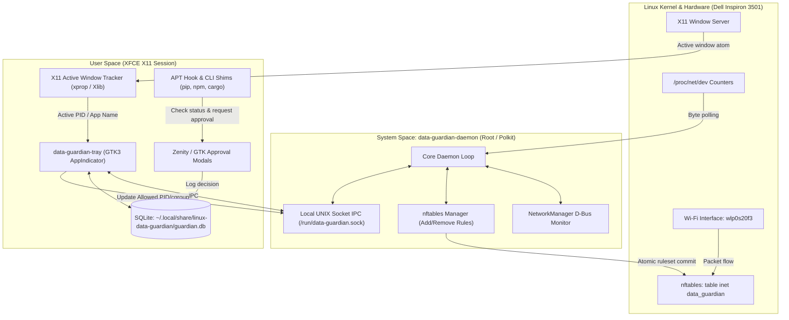

# Plan.md — Linux Data Guardian (Practical Implementation Plan)

> **Project:** Linux Data Guardian  
> **Target Machine:** Dell Inspiron 3501 (11th Gen Intel Core i3-1115G4, 3.6 GiB RAM, 11 GB free disk)  
> **Platform:** Linux Mint 22.3 (Zena) / Ubuntu 24.04 (Noble)  
> **Desktop Environment:** XFCE 4.18 (X11 Session)  
> **Primary Goal:** Control, monitor, and aggressively minimize mobile SIM data consumption when connected to a designated metered Wi-Fi hotspot.  
> **Implementation Stack:** Python 3.12, PyGObject (GTK3), SQLite 3, nftables, NetworkManager, Zenity/X11  
> **Architecture Status:** Practical Architecture Specification  
> **Guiding Principle:** **Monitor first, enforce cleanly, fail safely, zero bloat.**

---

## 1. Project Overview & Specific Problem Statement

### 1.1 The Problem
When connecting a laptop to a smartphone's mobile SIM hotspot (e.g., NTC mobile data packs), data is strictly metered, limited, and expensive. Standard desktop Linux distributions and applications routinely consume hundreds of megabytes in the background without explicit user permission:
- Automatic system update checks and metadata refreshes (APT, PackageKit, unattended-upgrades).
- Background application telemetry, auto-updaters, and cloud sync.
- Uncontrolled package installations (`apt install`, `pip`, `npm`, `cargo`) downloading dozens of megabytes of dependencies without prior size warnings.
- Background browser tabs or background processes continuing to stream or refresh while another app is in focus.

### 1.2 The Solution: Linux Data Guardian
A local-first, low-overhead daemon and XFCE system tray applet designed specifically for this laptop that:
1. **Auto-detects the designated metered mobile hotspot** via NetworkManager connection UUID.
2. **Applies Data Saver policies only on the metered hotspot** and restores completely unrestricted normal networking on home/office Wi-Fi.
3. **Supports two distinct, user-selectable Data Saver profiles**:
   - **Balanced Data Saver:** Silences all background OS updates, telemetry, and background services while permitting standard web surfing (Brave) and whitelisted developer tools (OpenCode CLI, Antigravity CLI, Git). Prompts before package/dependency downloads.
   - **Strict Mode (Foreground-Only):** In addition to Balanced restrictions, allows internet access *only* to the window currently in focus in XFCE (via X11 `_NET_ACTIVE_WINDOW`) plus whitelisted background CLI tools.
4. **"Download Only When I Approve" Gating:**
   - Intercepts APT package downloads before execution via `/etc/apt/apt.conf.d/` pre-download hooks.
   - Intercepts developer package managers (`pip`, `npm`, `cargo`) via smart shims.
   - Pops up a desktop approval prompt showing estimated download size and package names with Approve/Deny buttons.
5. **Real-time Accounting & Quotas:** Tracks total hotspot consumption accurately from `/proc/net/dev`, enforces daily/monthly data caps, and stores history in a local SQLite database.
6. **Failsafe Recovery:** Isolated in a dedicated `nftables` table (`table inet data_guardian`) that can be wiped cleanly at any moment via a one-line emergency script (`scripts/emergency-disable.sh`) without touching system UFW rules.

---

## 2. Hardware and Environment Specifications

All components are tailored to the detected specifications of this laptop to guarantee negligible resource usage:

| Attribute | Detected Specification | Architectural Rule |
| :--- | :--- | :--- |
| **Laptop Model** | Dell Inspiron 3501 | Intel i3-1115G4 (2 cores, 4 threads @ 3.00GHz). Event-driven (no polling loops). |
| **Available RAM** | 3.6 GiB total (~2.3 GiB free) | Memory footprint must stay **< 40 MB**. No Electron, no web dashboards, no Chromium processes. |
| **Disk Space** | 36 GB root partition (11 GB free, 68% used) | Minimal disk writes. SQLite WAL mode. No Docker, no heavyweight multi-GB environments. |
| **OS / Kernel** | Linux Mint 22.3 / Kernel 7.0.0-38-generic | Native integration with systemd, cgroups v2, and Linux netlink. |
| **Window System** | XFCE 4.18 on **X11** | Direct X11 window inspection via `xprop` / `xdotool` / `_NET_ACTIVE_WINDOW` (< 2ms response time). |
| **Firewall** | `nftables` 1.0.9 + `ufw` | Use dedicated `table inet data_guardian` with custom priority. Never edit or overwrite UFW tables. |
| **Native Tooling** | Python 3.12, PyGObject, Zenity, notify-send, nmcli | Use pre-installed native tools exclusively; zero unnecessary external package dependencies. |

---

## 3. Core Functional Requirements

### 3.1 Hotspot Detection & Scoping
1. Listen to NetworkManager state signals over D-Bus (`org.freedesktop.NetworkManager`).
2. Identify the active Wi-Fi connection UUID.
3. Compare against the user-configured **Designated Hotspot UUID**:
   - **Match:** Automatically activate the configured Data Saver policy (Balanced or Strict). Set NetworkManager `connection.metered: yes`.
   - **Different Wi-Fi / Ethernet:** Automatically deactivate all restrictions, flush the `nftables` guardian table, and return to ordinary monitoring.
4. Provide an immediate **Manual Bypass / Toggle** in the XFCE system tray.

### 3.2 Dual-Profile Data Saver
The user can toggle between two enforcement profiles from the tray icon:

#### Profile A: Balanced Data Saver (Recommended Default)
- **Allowed:**
  - Standard web browsing (e.g. Brave, Firefox) in foreground or background.
  - Whitelisted CLI coding agents (`opencode`, `antigravity`, `git`).
  - DNS resolution to local resolver / trusted DNS.
  - Local loopback traffic (`lo`).
- **Blocked:**
  - Automatic system update checks (`packagekitd`, `unattended-upgrades`, `apt-daily`).
  - Background telemetry, crash reporters, and OS background pings.
  - Non-whitelisted background daemon traffic.
- **Gated:**
  - Manual package installations (`apt`, `pip`, `npm`, `cargo`) trigger an approval prompt.

#### Profile B: Strict Mode (Foreground-Only)
- Includes all restrictions of Balanced Data Saver, plus:
- Outbound internet access is dynamically restricted to the PID of the **active X11 window** (plus whitelisted background CLI processes).
- When switching away from a browser or app, background connections for that app are paused/dropped until the window is focused again.
- Whitelisted CLI developer tools (`opencode`, `antigravity`, `git`) remain allowed to work continuously in the background.

### 3.3 Package & Dependency Download Approvals ("Only Download When Approved")
No supported tool may initiate an internet download on the metered hotspot without explicit user consent.

#### A. APT Integration
- Install `/etc/apt/apt.conf.d/99data-guardian`:
  - Hooks into `APT::Update::Pre-Invoke` and `DPkg::Pre-Invoke` (or `APT::Acquire::Pre-Invoke`).
  - Checks if the active connection is the metered hotspot and Data Saver is active.
  - Extracts the package list and estimated download size (`apt-get --print-uris` or package calculation).
  - Prompts the user with a modal dialog (Zenity/GTK):
    ```text
    [ Linux Data Guardian — Download Approval ]
    Operation: APT Package Installation
    Packages: python3-requests, libssl3 (2 packages)
    Estimated Download: 14.8 MB
    
    [ Approve Download ]    [ Deny / Cancel ]
    ```
  - If **Deny** or timeout: Exits with non-zero status. APT immediately aborts before downloading.
  - If **Approve**: Permitted once for that specific operation.

#### B. Developer Tools (pip, npm, cargo)
- Provide transparent wrappers/shims in `~/.local/bin/` (takes precedence in `$PATH`):
  - When `pip install ...`, `npm install ...`, or `cargo build/install ...` is invoked:
  - If on metered hotspot: Prompts in terminal or Zenity with estimated scope.
  - Records the user's decision in the SQLite database.

### 3.4 Accurate Traffic Accounting & Quotas
1. **Interface Totals:** Read byte counters from `/proc/net/dev` for the wireless interface (`wlp0s20f3`) at regular intervals (e.g., every 5 seconds when metered, every 30 seconds when idle).
2. **Quota Engine:**
   - User-defined **Daily Budget** (e.g., 500 MB) and **Monthly Budget** (e.g., 10 GB).
   - Warning notification at 80% and 95% of quota via `notify-send`.
   - On 100% quota exhaustion: Default drop all non-DNS outbound traffic until the user grants an explicit **Temporary Allowance** (e.g., +100 MB) or disables enforcement.
3. **Database Schema:** Local SQLite (`~/.local/share/linux-data-guardian/guardian.db`) recording:
   - `sessions`: Start/end times, SSID, connection UUID, total bytes uploaded and downloaded.
   - `daily_usage`: Date, bytes downloaded, bytes uploaded, quota limit, quota exceeded flag.
   - `approval_events`: Timestamp, tool (`apt`, `pip`, etc.), packages/summary, estimated size, decision (`approved` / `denied`).

### 3.5 Fail-Safe Design & Emergency Recovery
- **Rule Isolation:** All firewall rules exist inside `table inet data_guardian`. Never modify base system chains (`INPUT`, `FORWARD`, `OUTPUT` of `filter`).
- **Emergency Script (`scripts/emergency-disable.sh`):**
  - Runs `nft delete table inet data_guardian 2>/dev/null || true`.
  - Removes temporary hooks/locks.
  - Restores 100% unrestricted network access immediately, callable from terminal or hotkey without launching the GUI.
- **Fail-Open Policy:** If the daemon or tray applet crashes, the system must never permanently lock the user out of their internet connection.

---

## 4. Technical Architecture



---

## 5. Repository Structure

```text
linux-data-guardian/
├── README.md
├── plan.md                                # This practical blueprint
├── config/
│   ├── config.default.yaml                # Default policies, quotas, thresholds
│   └── whitelist.yaml                     # Whitelisted CLI tools & services
├── src/
│   └── data_guardian/
│       ├── __init__.py
│       ├── config.py                      # YAML config parser & validator
│       ├── database.py                    # SQLite schema, queries, migrations
│       ├── daemon.py                      # Background system daemon
│       ├── ipc.py                         # UNIX socket client/server communication
│       ├── network/
│       │   ├── nm_monitor.py              # NetworkManager D-Bus connection listener
│       │   └── byte_counter.py            # /proc/net/dev interface statistics
│       ├── firewall/
│       │   ├── nft_manager.py             # Scoped nftables table & rule builder
│       │   └── rulesets.py                # Balanced vs Strict vs Bypass rules
│       ├── window_tracker/
│       │   └── x11_tracker.py             # Active X11 window PID resolver
│       ├── approvals/
│       │   ├── apt_hook.py                # APT pre-download inspection & prompt
│       │   └── shims.py                   # pip / npm / cargo wrappers
│       └── ui/
│           ├── tray.py                    # XFCE GTK3 AppIndicator tray applet
│           ├── dashboard.py               # Lightweight GTK3 status window
│           └── dialogs.py                 # Zenity / GTK approval prompts
├── scripts/
│   ├── install.sh                         # Install hooks, systemd unit, desktop entry
│   ├── uninstall.sh                       # Clean uninstaller (leaves no residue)
│   └── emergency-disable.sh               # Instant firewall flush & recovery
├── systemd/
│   ├── data-guardian.service              # Root systemd unit for firewall & accounting
│   └── data-guardian-tray.desktop         # User autostart entry for XFCE session
└── tests/
    ├── test_nm_monitor.py
    ├── test_byte_counter.py
    ├── test_firewall_rules.py
    └── test_database.py
```

---

## 6. Development & Delivery Phases

### Phase 1: Foundations, Storage & Emergency Safety (Week 1)
- [ ] Create `scripts/emergency-disable.sh` and verify it flushes rules cleanly without touching UFW.
- [ ] Implement `src/data_guardian/database.py` with SQLite schema (`sessions`, `daily_usage`, `approval_events`).
- [ ] Implement `src/data_guardian/config.py` with default YAML configuration.
- [ ] Implement `src/data_guardian/network/byte_counter.py` reading `/proc/net/dev` for accurate interface usage tracking.
- [ ] Write unit tests for database and byte counter.

### Phase 2: NetworkManager Detection & Hotspot Scoping (Week 1)
- [ ] Implement `src/data_guardian/network/nm_monitor.py` listening to NetworkManager D-Bus signals.
- [ ] Add connection UUID matching for the designated NTC mobile hotspot.
- [ ] Verify state transitions:
  - Connected to Hotspot -> Metered mode engaged.
  - Connected to Wi-Fi / Disconnected -> Normal mode engaged.
- [ ] Integrate with systemd service definition (`systemd/data-guardian.service`).

### Phase 3: "Download Only When I Approve" Gating (Week 2)
- [ ] Implement APT hook (`/etc/apt/apt.conf.d/99data-guardian`):
  - Parse requested packages and download size estimate.
  - Spawn desktop approval modal via `zenity` (or GTK fallback).
  - Cancel execution cleanly on Deny or timeout.
- [ ] Implement dev tool shims (`pip`, `npm`, `cargo`) in `~/.local/bin/`.
- [ ] Log all approved/denied events in SQLite `approval_events`.

### Phase 4: nftables Data Saver Engine (Balanced & Strict Profiles) (Week 2)
- [ ] Implement `src/data_guardian/firewall/nft_manager.py`:
  - Manage dedicated `table inet data_guardian`.
  - Balanced ruleset: drop background system update daemons, allow browsing & whitelisted CLI.
  - Strict ruleset: integrate X11 active window tracking to filter outbound traffic to focused window PID + whitelisted tools.
- [ ] Implement `src/data_guardian/window_tracker/x11_tracker.py` for XFCE.
- [ ] Test quota boundary enforcement (stopping outbound traffic when limit reached).

### Phase 5: XFCE System Tray Applet & User Dashboard (Week 3)
- [ ] Implement `src/data_guardian/ui/tray.py` using GTK3 (`PyGObject`):
  - Colored status icon (Green = Unrestricted, Amber = Balanced, Blue = Strict).
  - Right-click menu: Toggle Data Saver (Off / Balanced / Strict), Temporary +100MB, Open Dashboard, Emergency Bypass.
- [ ] Implement `src/data_guardian/ui/dashboard.py`:
  - Shows today's usage, remaining budget, active network, and recent approval logs.
- [ ] Integrate autostart entry (`data-guardian-tray.desktop`) for XFCE.

### Phase 6: End-to-End Testing & Verification (Week 3)
- [ ] Sleep/Wake test: Verify policies re-evaluate properly upon resume.
- [ ] Reconnect test: Toggle phone hotspot off/on and verify automatic policy re-engagement.
- [ ] Data leak test: Measure background data consumption over 30 minutes in Balanced and Strict modes.
- [ ] Emergency recovery test: Run `scripts/emergency-disable.sh` during active block and verify instant connection restoration.

---

## 7. Critical Safety & Reliability Commitments

1. **Zero System Corruption:** Never modify `/etc/ufw/` or overwrite system firewall configuration. All rules reside in an isolated `nftables` namespace.
2. **Never Leave the User Offline:** If the UI crashes, approval dialogs fail, or an unknown error occurs, the fail-safe recovery script immediately restores open networking.
3. **No Unwanted Resource Overhead:** The entire background daemon and tray applet together must use **< 40 MB of RAM** and **< 0.5% CPU** when idle.
4. **Honest Accounting:** The application will display exact byte counts from `/proc/net/dev` and will never claim a connection was blocked unless confirmed by firewall counter rules.
