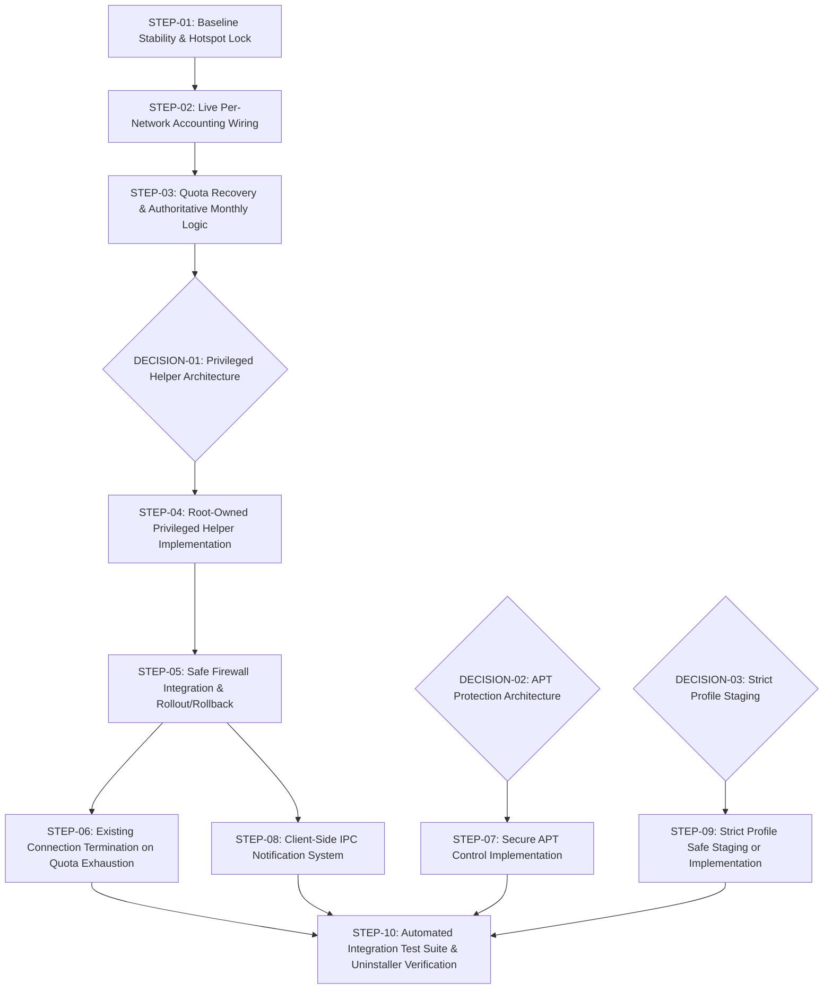

# Linux Data Guardian — Phase 1 Implementation Roadmap (Revision 2)

**Based On:** `audit.md` (Revision 2, Commit `7caf94d`)  
**Objective:** Establish a safe, verifiable, and secure foundation for data monitoring, accounting, and quota enforcement on Linux Mint XFCE.  
**Execution Boundary:** Planning only. No system changes, privileged commands, or optimizations may be executed without explicit user authorization.

---

## Roadmap Dependency Graph



---

## Implementation Steps

### STEP-01: Baseline Stability & Immutable Hotspot Designation
- **Objective:** Ensure designated hotspot selection is strictly permanent, immutable against UI dropdown state changes, and verified against real NetworkManager UUIDs.
- **Problems Addressed:** Inadvertent network flapping; UI selection resetting designated hotspot in `config.yaml`.
- **Target Files:**
  - `src/data_guardian/network/nm_monitor.py`
  - `src/data_guardian/ui/dashboard.py`
  - `src/data_guardian/config.py`
- **Implementation Approach:**
  - Remove implicit auto-save on dropdown `changed` events in `dashboard.py`. Hotspot assignment must occur *only* when the user explicitly clicks the "⭐ Set as Hotspot" button or runs `data-guardian set-hotspot <target>`.
  - In `nm_monitor.py`, require strict UUID matching. The fallback name match must only activate if `designated_uuid` is empty, avoiding ambiguous matches with nearby networks.
  - Persist `designated_uuid` directly into `~/.config/linux-data-guardian/config.yaml`.
- **Dependencies:** None (Zero privileged operations required).
- **Automated Tests:**
  - Unit test verifying that switching the UI dropdown does not alter `ConfigManager.designated_hotspot_uuid`.
  - Unit test verifying `nm_monitor.poll_check()` ignores name collisions when `designated_uuid` is configured.
- **Acceptance Criteria:**
  - `data-guardian status` consistently displays `Moto Mobile` as designated hotspot.
  - Selecting `ALHN-449C` in dashboard overview changes view statistics only, leaving designated hotspot unchanged.
  - No flapping entries in system logs.

---

### STEP-02: Live Per-Network Traffic Accounting Wiring
- **Objective:** Connect the live monitoring loop to the `network_daily_usage` SQLite table so that live usage per network is recorded continuously.
- **Problems Addressed:** `BUG-001` (Live statistics chart and summary table only show migration snapshot).
- **Target Files:**
  - `src/data_guardian/daemon.py`
  - `src/data_guardian/database.py`
- **Implementation Approach:**
  - In `daemon.py:_iteration()`, update the `self.db.record_usage_delta()` call to pass the active connection's metadata:
    ```python
    usage = self.db.record_usage_delta(
        delta_rx=delta_rx,
        delta_tx=delta_tx,
        quota_limit_bytes=daily_limit_bytes,
        connection_uuid=active_conn.uuid,
        connection_name=active_conn.name,
    )
    ```
  - In `database.py`, ensure the upsert cleanly updates both aggregate `daily_usage` and per-network `network_daily_usage`.
- **Dependencies:** STEP-01.
- **Automated Tests:**
  - Unit test running mock byte deltas through `record_usage_delta()` with specific UUIDs and verifying both tables update accurately.
- **Acceptance Criteria:**
  - While actively transferring data, `SELECT * FROM network_daily_usage WHERE date = date('now')` increases in real time.
  - The dashboard Statistics tab immediately reflects live consumption for the active network.

---

### STEP-03: Quota Recovery on Restart & Authoritative Monthly Logic
- **Objective:** Ensure quota-exhausted state persists across daemon restarts, and implement authoritative monthly quota calculation.
- **Problems Addressed:** Missing monthly quota enforcement; quota-blocked state reset if daemon restarts.
- **Target Files:**
  - `src/data_guardian/database.py`
  - `src/data_guardian/daemon.py`
- **Implementation Approach:**
  - In `database.py`, add `get_monthly_usage(connection_uuid, billing_cycle_day=1)`:
    - Calculates date boundaries from current date and billing cycle day.
    - Sums `rx_bytes + tx_bytes` from `network_daily_usage` exclusively for the designated metered UUID.
  - In `daemon.py:__init__()`:
    - On startup, query `db.get_today_usage()` and `db.get_monthly_usage()`.
    - If either daily total $\ge$ daily limit OR monthly total $\ge$ monthly limit, initialize `self._is_quota_blocked = True` immediately.
  - In `daemon.py:_iteration()`:
    - Check monthly quota exhaustion alongside daily quota exhaustion.
- **Dependencies:** STEP-02.
- **Automated Tests:**
  - Test verifying monthly aggregation across calendar and arbitrary billing-cycle boundaries.
  - Test initializing daemon with pre-populated exhausted database, verifying `_is_quota_blocked` is True before any packet is counted.
- **Acceptance Criteria:**
  - Exceeding monthly limit triggers quota-exhausted state.
  - Restarting `data-guardian.service` while over quota retains `is_quota_blocked: true`.

---

### STEP-04: Root-Owned Privileged Helper Design & Implementation
> ⛔ **BLOCKED: Requires User Approval on DECISION-01.**
- **Objective:** Create a dedicated, secure privileged execution helper owned by root to manage `table inet data_guardian` without exposing arbitrary `nft` access.
- **Problems Addressed:** `SEC-001` (Complete failure of unprivileged daemon to apply firewall rules).
- **Target Files:**
  - `scripts/data-guardian-helper` (Installed to `/usr/local/libexec/data-guardian-helper`)
  - `/etc/sudoers.d/linux-data-guardian` (Managed via user manual sudo step)
  - `src/data_guardian/firewall/nft_manager.py`
- **Helper Specification:**
  - Ownership: `root:root`, Permissions: `0755`.
  - Written in hardened POSIX bash with strict error handling (`set -euo pipefail`).
  - Accepted Actions:
    1. `--apply-balanced <iface>`: Validates interface name against regex `^[a-zA-Z0-9_\.\-]+$`. Compiles balanced ruleset, runs `nft -c -f -` (syntax validation), then atomically applies via `nft -f -`.
    2. `--apply-strict <iface>`: Validates interface name and applies strict ruleset.
    3. `--apply-blocked <iface>`: Applies quota-exhausted ruleset.
    4. `--flush`: Deletes `table inet data_guardian`.
    5. `--status`: Returns exit code 0 if table exists, 1 otherwise.
  - Any unknown flag, extra arguments, or unvalidated characters abort with error code 2.
- **Sudoers Rule:**
  ```sudoers
  jagdish ALL=(root) NOPASSWD: /usr/local/libexec/data-guardian-helper --apply-balanced [a-zA-Z0-9_\.\-]*
  jagdish ALL=(root) NOPASSWD: /usr/local/libexec/data-guardian-helper --apply-strict [a-zA-Z0-9_\.\-]*
  jagdish ALL=(root) NOPASSWD: /usr/local/libexec/data-guardian-helper --apply-blocked [a-zA-Z0-9_\.\-]*
  jagdish ALL=(root) NOPASSWD: /usr/local/libexec/data-guardian-helper --flush
  jagdish ALL=(root) NOPASSWD: /usr/local/libexec/data-guardian-helper --status
  ```
- **Dependencies:** DECISION-01 approval, STEP-01.
- **Verification Method:**
  - Calling helper with invalid arguments (`--delete-all`, `rm -rf`, `; ls`) fails with exit code 2.
  - Calling `--status` returns exit code 0 or 1 without prompt.

---

### STEP-05: Safe Firewall Integration & Rollout/Rollback
- **Objective:** Connect `NftablesManager` to the privileged helper with verified syntax validation, atomic commits, and automatic error rollback.
- **Problems Addressed:** Unhandled subprocess failures, stale rulesets, failed profile transitions.
- **Target Files:**
  - `src/data_guardian/firewall/nft_manager.py`
  - `src/data_guardian/firewall/rulesets.py`
  - `src/data_guardian/daemon.py`
- **Implementation Approach:**
  - `NftablesManager.apply_profile()` delegates directly to `sudo -n /usr/local/libexec/data-guardian-helper`.
  - Capture stdout/stderr and return code accurately.
  - If rule application fails, invoke `flush()` immediately to prevent half-configured or dangling firewall states.
  - In `daemon.py`, surface firewall errors to the IPC status response so the dashboard displays an alert if enforcement fails.
- **Dependencies:** STEP-04.
- **Automated Tests:**
  - Unit tests mocking helper execution with success, failure, and timeout scenarios.
- **Acceptance Criteria:**
  - `data-guardian profile balanced` successfully creates `table inet data_guardian` verifiable via `sudo nft list table inet data_guardian`.
  - Switching to `off` removes the table cleanly.
  - Other system tables (UFW, Docker) remain untouched.

---

### STEP-06: Existing Connection Handling on Quota Exhaustion
- **Objective:** Prevent active long-running downloads from bypassing daily/monthly quota limits after exhaustion.
- **Problems Addressed:** `BUG-002` (Established connections continue streaming data after limit is reached).
- **Target Files:**
  - `src/data_guardian/firewall/rulesets.py`
  - `scripts/data-guardian-helper`
- **Implementation Approach:**
  - In `rulesets.py:build_nft_ruleset()`, when `quota_exceeded=True`:
    - Do NOT place `ct state established,related accept` at the top of the chain for non-essential ports.
    - Explicitly allow established traffic *only* for essential system infrastructure: loopback (`lo`), DNS (53), DHCP (67, 68).
    - Drop all other traffic (`ct state {new, established, related} drop`).
    - Alternatively: In the privileged helper `--apply-blocked` action, execute `conntrack -D -i <interface>` (if `conntrack` utility is present) to immediately terminate active socket states.
- **Dependencies:** STEP-05.
- **Automated Tests:**
  - Rule generation test verifying established packet drop rules in quota-blocked mode.
- **Acceptance Criteria:**
  - When quota is reached during an active file download, throughput drops to 0 KB/s immediately.

---

### STEP-07: Secure APT Control Implementation
> ⛔ **BLOCKED: Requires User Approval on DECISION-02.**
- **Objective:** Eliminate the critical local privilege escalation flaw in the current APT hook while ensuring mobile data is protected from package manager downloads.
- **Problems Addressed:** `SEC-002` (Root executing user-writable code).
- **Target Files:**
  - `/etc/apt/apt.conf.d/99data-guardian`
  - `src/data_guardian/approvals/apt_hook.py`
  - `config/apt-hook-template.conf`
- **Implementation Approach (Assuming Recommended Option A — Firewall Sandbox):**
  - Remove the Python execution hook from `/etc/apt/apt.conf.d/99data-guardian`.
  - Replace with kernel-level enforcement: In Balanced mode on metered hotspot, `skuid 42 ct state new drop` physically blocks `_apt` downloads.
  - When the user runs `apt install` or clicks "+500 MB Allowance", `NftablesManager` opens a temporary exemption rule for UID 42 for a configurable window (e.g., 15 minutes).
  - Terminal shims (`pip`, `npm`, `cargo`) remain in `~/.local/bin/` as they run strictly in unprivileged user space.
- **Dependencies:** DECISION-02 approval, STEP-05.
- **Verification Method:**
  - Running `sudo apt update` or `sudo apt install curl` while on metered hotspot in Balanced mode fails to connect to mirrors (blocked at kernel level).
  - Running `data-guardian allow 100` temporarily permits APT downloads to proceed.

---

### STEP-08: Client-Side IPC Notification System
- **Objective:** Deliver reliable desktop notifications without hardcoding session bus paths, display variables, or running GUI code inside background services.
- **Problems Addressed:** `BUG-003` (Silent notification failures in background service).
- **Target Files:**
  - `src/data_guardian/daemon.py`
  - `src/data_guardian/ipc.py`
  - `src/data_guardian/ui/tray.py`
  - `src/data_guardian/ui/dashboard.py`
- **Implementation Approach:**
  - Maintain an event queue in the daemon.
  - When the tray applet (`ui/tray.py`) or dashboard (`ui/dashboard.py`) polls or listens on the IPC socket, the daemon transmits pending notifications in its status payload:
    ```json
    "pending_notifications": [
        {"title": "Data Warning (80%)", "message": "Used 800 MB of 1000 MB", "urgency": "critical"}
    ]
    ```
  - The UI component (which runs natively inside the active X11 desktop session with full access to `DISPLAY` and session D-Bus) calls `Notify.Notification` or `notify-send`.
- **Dependencies:** STEP-01.
- **Automated Tests:**
  - Unit test verifying event queue ingestion and consumption across IPC request cycles.
- **Acceptance Criteria:**
  - 80% warning and quota exhaustion pop up natively in the Linux Mint notification center.

---

### STEP-09: Strict Profile Safe Staging & Validation
> ⛔ **BLOCKED: Requires User Approval on DECISION-03.**
- **Objective:** Prevent networking lockups by safely staging Strict mode until cgroupv2 process hierarchy tracking is fully built and tested.
- **Problems Addressed:** `SEC-003` (Missing cgroup hierarchy leading to complete connectivity failure).
- **Target Files:**
  - `src/data_guardian/ui/dashboard.py`
  - `src/data_guardian/firewall/rulesets.py`
  - `src/data_guardian/window_tracker/x11_tracker.py`
- **Implementation Approach (Assuming Recommended Option A — Staged):**
  - Mark Strict mode in the Dashboard as "(Experimental - In Development)".
  - In `rulesets.py`, if Strict mode is requested, log a warning and fall back to Balanced mode rather than injecting non-existent cgroup rules that cause complete traffic drops.
- **Dependencies:** DECISION-03 approval.
- **Acceptance Criteria:**
  - Selecting Strict mode does not kill active browser connections or lock the system out of DNS.

---

### STEP-10: Automated Integration Test Suite & Uninstaller Verification
- **Objective:** Validate end-to-end operational integrity and verify that uninstallation cleanly purges all system modifications.
- **Target Files:**
  - `tests/test_integration.py`
  - `scripts/uninstall.sh`
  - `scripts/install.sh`
- **Implementation Approach:**
  - Add non-destructive integration tests:
    - Test full IPC roundtrip.
    - Test helper argument validation harness.
    - Test database consistency after abrupt simulated termination.
  - Audit `scripts/uninstall.sh` to ensure it removes `/usr/local/libexec/data-guardian-helper`, `/etc/sudoers.d/linux-data-guardian`, `/etc/apt/apt.conf.d/99data-guardian`, systemd unit files, and desktop autostart launchers without leaving orphaned rules or files.
- **Dependencies:** STEP-01 through STEP-09.
- **Acceptance Criteria:**
  - `pytest tests/ -v` passes 100% of unit and integration tests.
  - Clean uninstall leaves zero residual firewall rules, sudoers entries, or broken shims.

---

## Phase 2: Candidate Optimization Backlog
*(Blocked until Phase 1 completion is explicitly reviewed and approved by user)*

- Event-driven NetworkManager monitoring using libnm GObject signals (replaces 5s polling).
- SQLite query indexing and automated 90-day pruning routine.
- Dynamic lazy-loading of Matplotlib figure canvas to optimize GUI startup time.
- Memory footprint optimization to ensure daemon maintains $< 15\text{ MB}$ RSS.

---
*End of Implementation Roadmap. No changes have been implemented.*
